# 在线学籍管理系统--论文

> 🎓 **计算机毕业设计 · 在线学籍管理系统--论文**
>
> 本仓库只放**项目介绍 + 运行截图**（截图是站点带水印的原图，存在仓库 `images/` 里）。
>
> 👉 **完整可运行源码 / 数据库脚本 / 部署文档：[点我获取](https://geekcode.top/archives/%E5%9C%A8%E7%BA%BF%E5%AD%A6%E7%B1%8D%E7%AE%A1%E7%90%86%E7%B3%BB%E7%BB%9F-%E8%AE%BA%E6%96%87?utm_source=github)**
>
> 💬 咨询微信：**ir9372**　|　🌐 更多项目：[极客代码 geekcode.top](https://geekcode.top/?utm_source=github)
>
> 📌 项目详情页：<https://geekcode.top/archives/%E5%9C%A8%E7%BA%BF%E5%AD%A6%E7%B1%8D%E7%AE%A1%E7%90%86%E7%B3%BB%E7%BB%9F-%E8%AE%BA%E6%96%87?utm_source=github>

<table><td width="230" align="center"> <b>扫码加微信 ir9372</b></td><td valign="middle">📦 源码 = 项目介绍 + 全部运行截图 + 数据库 + 部署文档 👉 点上方任意截图，直接跳到 <b>极客代码 geekcode.top</b> 详情页</td></table>

---

<h1>在线学籍管理系统--论文</h1>
<h2>项目概述</h2>

本项目为“在线学籍管理系统”，旨在构建一个高效、安全的后台管理平台，用于集中化管理学生学籍、成绩及教学相关基础数据。系统核心功能涵盖学生信息管理、班级与专业配置、教师档案维护、课程信息录入以及学生成绩与学籍状态的记录与查询。该主要面向高校教务管理人员或管理员使用，解决传统纸质或分散式电子表格管理模式下数据冗余、更新滞后及权限混乱的问题。技术架构上，后端采用 Spring Boot 框架结合 MyBatis-Plus 实现持久层操作，利用 Shiro 进行安全认证与授权，数据库选用 MySQL。前端基于 Vue 框架构建集成式管理界面，整体设计遵循前后端分离的开发模式，确保系统的可维护性与扩展性。

<h2>技术架构</h2>
<h3>总体架构</h3>

系统采用经典的 B/S（浏览器/服务器）架构，具体表现为前后端分离的开发模式。虽然项目类型为 <code>vue-integrated</code>，但根据路由配置仅存在后台路由且无前台导航菜单，表明这是一个纯后台管理系统。

<a href="https://geekcode.top/archives/%E5%9C%A8%E7%BA%BF%E5%AD%A6%E7%B1%8D%E7%AE%A1%E7%90%86%E7%B3%BB%E7%BB%9F-%E8%AE%BA%E6%96%87?utm_source=github" title="查看完整源码">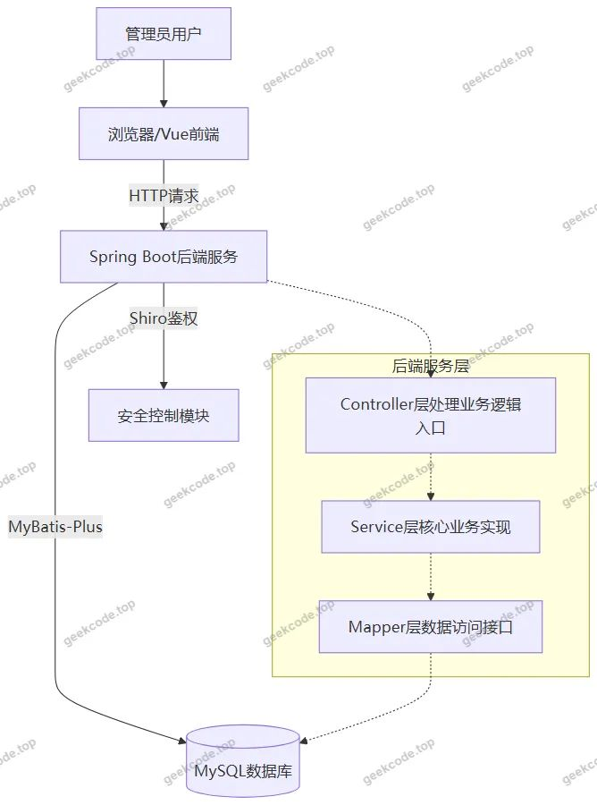</a>

<h3>核心技术选型理由</h3>
<ol>
<li><strong>Spring Boot</strong>: 作为后端基础框架，提供了自动配置和起步依赖，极大地简化了 Web 应用的搭建过程，快速构建 RESTful API 接口。</li>
<li><strong>MyBatis-Plus</strong>: 在 MyBatis 基础上增强，提供通用的 CRUD 操作封装，减少了大量重复的 SQL 编写工作，提升了开发效率，适合本项目中标准化的增删改查需求。</li>
<li><strong>Apache Shiro</strong>: 用于实现系统的安全认证（Authentication）和授权（Authorization）。通过 Shiro 拦截器保护后台路由，确保只有经过身份验证的管理员才能访问敏感数据如学生成绩和学籍信息。</li>
<li><strong>MySQL</strong>: 关系型数据库，稳定可靠，适合存储结构化的学籍、成绩及基础字典数据。</li>
<li><strong>Vue.js (Integrated)</strong>: 前端采用 Vue 框架，结合 Element UI 等组件库（推测自常见毕设实践，虽未明确列出UI库，但Vue通常配合此类组件），提供响应式的后台管理界面体验。</li>
</ol>
<h3>数据库设计要点</h3>

根据控制器列表推断，数据库主要包含以下核心实体表：

<ul>
<li><strong>Users</strong>: 存储管理员账户信息及登录凭证。</li>
<li><strong>Xuesheng</strong>: 学生基本信息表。</li>
<li><strong>Jiaoshi</strong>: 教师基本信息表。</li>
<li><strong>Banjixinxi</strong>: 班级信息表，关联专业与学生。</li>
<li><strong>Zhuanye</strong>: 专业信息表。</li>
<li><strong>Yuanxiao</strong>: 院校信息表。</li>
<li><strong>Kechengxinxi</strong>: 课程信息表。</li>
<li><strong>Xueshengchengji</strong>: 学生成绩表，关联学生与课程。</li>
<li><strong>Xueshengxueji</strong>: 学生学籍状态表，记录入学、毕业等状态变更。</li>
</ul>
<h2>功能模块</h2>

由于项目明确标识“是否有前台: 否”且“个人中心菜单”为空，所有功能均集中在后台管理端。

<h3>后台管理端功能</h3>

后台首页作为系统入口，展示关键数据统计概览（根据截图“后台首页(admin)”推断）。其余模块对应具体的业务实体管理：

<ol>
<li><strong>登录模块</strong></li>
</ol>
<ul>
<li>功能描述：管理员输入账号密码进行身份验证，成功后进入系统主界面。</li>
<li>涉及组件：<code>UsersController</code>, <code>Shiro</code> 认证过滤器。</li>
</ul>
<ol start="2">
<li><strong>学生信息管理 (<code>/xuesheng</code>)</strong></li>
</ol>
<ul>
<li>功能描述：对学生的基本档案进行增、删、改、查操作。包括姓名、学号、联系方式等基础信息的维护。</li>
<li>涉及组件：<code>XueshengController</code>。</li>
</ul>
<ol start="3">
<li><strong>班级信息管理 (<code>/banjixinxi</code>)</strong></li>
</ol>
<ul>
<li>功能描述：管理班级建制，设置班级名称、所属专业、班主任等信息，并可将学生分配至特定班级。</li>
<li>涉及组件：<code>BanjixinxiController</code>。</li>
</ul>
<ol start="4">
<li><strong>教师信息管理 (<code>/jiaoshi</code>)</strong></li>
</ol>
<ul>
<li>功能描述：维护教师的基本资料，如工号、职称、授课方向等，便于后续课程关联。</li>
<li>涉及组件：<code>JiaoshiController</code>。</li>
</ul>
<ol start="5">
<li><strong>院校信息管理 (<code>/yuanxiao</code>)</strong></li>
</ol>
<ul>
<li>功能描述：管理学校的基础信息，可能包括校区地址、联系电话、简介等静态数据。</li>
<li>涉及组件：<code>YuanxiaoController</code>。</li>
</ul>
<ol start="6">
<li><strong>学生成绩管理 (<code>/xueshengchengji</code>)</strong></li>
</ol>
<ul>
<li>功能描述：录入、修改和查询学生的各科考试成绩。支持按学生或课程维度检索成绩记录。</li>
<li>涉及组件：<code>XueshengchengjiController</code>。</li>
</ul>
<ol start="7">
<li><strong>学生学籍管理 (<code>/xueshengxueji</code>)</strong></li>
</ol>
<ul>
<li>功能描述：跟踪学生的学籍状态变化，如注册、休学、复学、退学、毕业等流程的记录与管理。</li>
<li>涉及组件：<code>XueshengxuejiController</code>。</li>
</ul>
<ol start="8">
<li><strong>课程信息管理 (<code>/kechengxinxi</code>)</strong></li>
</ol>
<ul>
<li>功能描述：定义课程体系，包括课程名称、学分、课时、考核方式及关联的教师信息。</li>
<li>涉及组件：<code>KechengxinxiController</code>。</li>
</ul>
<ol start="9">
<li><strong>专业信息管理 (<code>/zhuanye</code>)</strong></li>
</ol>
<ul>
<li>功能描述：维护学校的专业目录，设置专业名称、代码、所属院系等元数据。</li>
<li>涉及组件：<code>ZhuanyeController</code>。</li>
</ul>
<ol start="10">
<li><strong>通用配置与文件管理</strong></li>
</ol>
<ul>
<li>功能描述：处理系统参数配置及文件上传下载服务（如头像、附件等）。</li>
<li>涉及组件：<code>ConfigController</code>, <code>FileController</code>, <code>CommonController</code>。</li>
</ul>
<h2>用户角色与权限</h2>

根据现有源码结构和截图显示，系统仅存在一种主要的操作角色：<strong>管理员 (admin)</strong>。

<ul>
<li><strong>角色名称</strong>: 管理员</li>
<li><strong>权限范围</strong>: </li>
<li><strong>完全控制权</strong>: 拥有对所有业务模块（学生、教师、班级、成绩、学籍、课程、专业、院校）的数据查看、新增、编辑和删除权限。</li>
<li><strong>系统配置权</strong>: 可以访问 <code>ConfigController</code> 和 <code>FileController</code>，具备修改系统基础配置和管理上传文件的能力。</li>
<li><strong>安全认证</strong>: 必须通过 Shiro 框架的身份验证方可访问任何后台路由 <code>/xuesheng</code>, <code>/banjixinxi</code> 等。</li>
<li><strong>其他角色说明</strong>: </li>
<li>项目中未体现普通用户（如学生本人、教师本人）的前台登录入口或个人中心功能。因此，学生和教师在本系统中仅作为被管理的“数据对象”存在，不具备直接操作系统界面的权限。</li>
<li>根据现有信息无法确定是否存在多级别管理员（如超级管理员与普通教务管理员的区分），默认视为单一超级管理员角色。</li>
</ul>
<h2>项目特色与创新点</h2>
<ol>
<li>
<strong>高度集成的后台管理体验</strong>: 
   采用 <code>vue-integrated</code> 模式，将前端视图与后端逻辑紧密整合，减少了跨域配置复杂度，提升了部署便捷性。界面风格统一，符合现代 SaaS 管理平台的审美标准。

</li>
<li>
<strong>标准化的数据模型设计</strong>: 
   通过 MyBatis-Plus 的强类型映射，实现了从 Entity 到 DTO 再到 VO 的清晰分层。针对学籍管理这一复杂场景，将“学籍状态” (<code>Xueshengxueji</code>) 与“学生基本信息” (<code>Xuesheng</code>) 分离，体现了对业务逻辑解耦的思考，便于历史数据的追溯。

</li>
<li>
<strong>基于 Shiro 的安全防护机制</strong>: 
   引入 Apache Shiro 而非简单的 Session 拦截，提供了更细粒度的权限控制能力。即使当前仅有单一角色，其架构也为未来扩展多角色（如只读教师、受限教务员）预留了空间。

</li>
<li>
<strong>模块化控制器设计</strong>: 
   每个业务实体（学生、班级、成绩等）都有独立的 Controller 类，职责单一，代码结构清晰，易于维护和单元测试。例如 <code>XueshengchengjiController</code> 专门处理成绩逻辑，避免了与其他业务逻辑耦合。

</li>
</ol>
<h2>部署环境</h2>

为确保系统正常运行，需准备以下软件环境：

<ol>
<li><strong>Java 运行环境</strong>:</li>
</ol>
<ul>
<li>JDK 版本: 建议 JDK 1.8 或更高版本（兼容 Spring Boot 2.x 系列）。</li>
<li>作用: 编译和运行后端 Java 代码。</li>
</ul>
<ol start="2">
<li><strong>数据库服务</strong>:</li>
</ol>
<ul>
<li>MySQL: 版本 5.7 或 8.0+。</li>
<li>配置: 需创建对应的数据库实例，并导入项目提供的 SQL 初始化脚本以建立表结构（Users, Xuesheng, etc.）。</li>
</ul>
<ol start="3">
<li><strong>构建工具</strong>:</li>
</ol>
<ul>
<li>Maven: 用于管理后端项目的依赖包（Spring Boot, MyBatis-Plus, Shiro 等）及打包构建。</li>
</ul>
<ol start="4">
<li><strong>前端运行环境</strong>:</li>
</ol>
<ul>
<li>Node.js: 建议 LTS 版本（如 v14 或 v16+），用于安装 npm 依赖。</li>
<li>npm/yarn: 包管理器，用于安装 Vue 及相关前端库。</li>
<li>注意: 若为 <code>vue-integrated</code> 模式，可能需要先执行前端构建命令生成静态资源，再将其放入后端 <code>static</code> 或 <code>templates</code> 目录，或通过反向代理部署。</li>
</ul>
<ol start="5">
<li><strong>Web 容器</strong>:</li>
</ol>
<ul>
<li>Tomcat: Spring Boot 内置 Tomcat，无需单独安装外部 Tomcat 服务器，直接通过 <code>java -jar</code> 启动即可。</li>
</ul>
<h2>五、技术特性</h2>
<ul>
<li>前后端集成部署，前端资源打包至后端 static 目录</li>
<li>使用 MyBatis-Plus 简化数据访问层开发</li>
<li>集成 Shiro 权限框架实现角色权限控制</li>
</ul>
<h2>六、功能模块截图</h2>
<h3>后台管理端</h3>
<h4>后台-班级信息</h4>

<a href="https://geekcode.top/archives/%E5%9C%A8%E7%BA%BF%E5%AD%A6%E7%B1%8D%E7%AE%A1%E7%90%86%E7%B3%BB%E7%BB%9F-%E8%AE%BA%E6%96%87?utm_source=github" title="查看完整源码">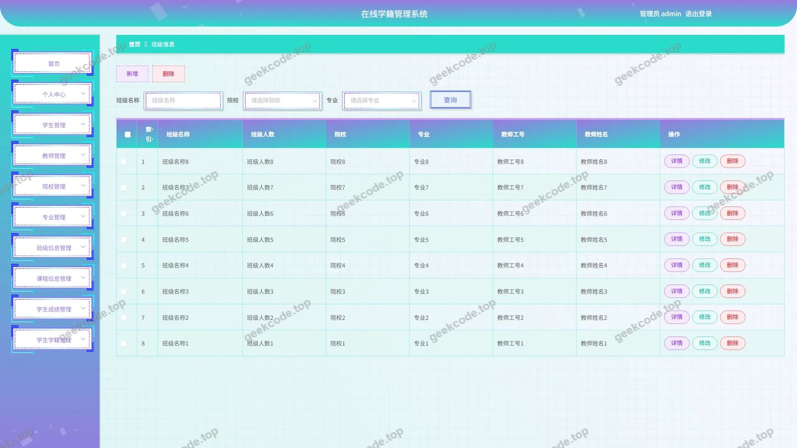</a>

<h4>后台首页</h4>

<a href="https://geekcode.top/archives/%E5%9C%A8%E7%BA%BF%E5%AD%A6%E7%B1%8D%E7%AE%A1%E7%90%86%E7%B3%BB%E7%BB%9F-%E8%AE%BA%E6%96%87?utm_source=github" title="查看完整源码">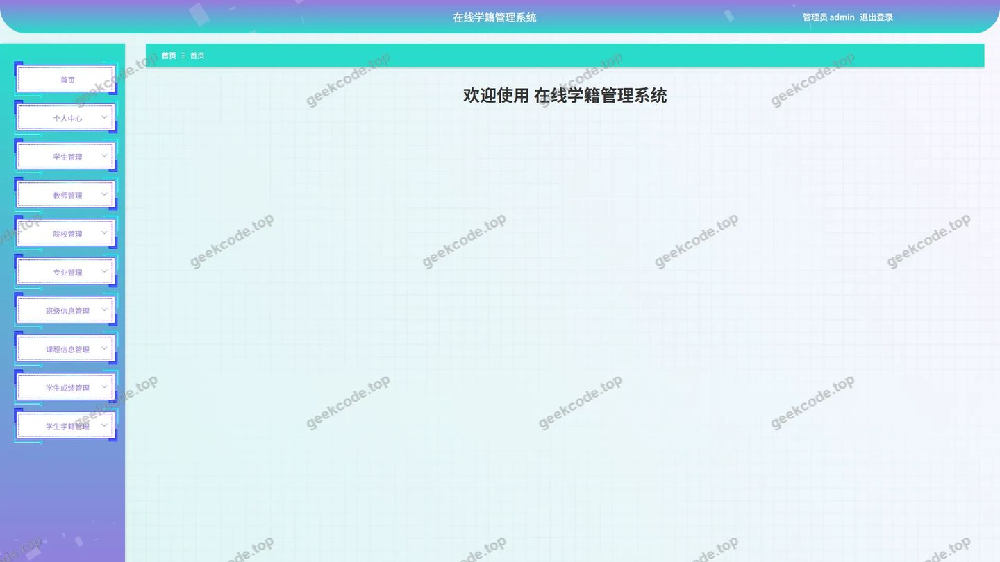</a>

<h4>后台-教师</h4>

<a href="https://geekcode.top/archives/%E5%9C%A8%E7%BA%BF%E5%AD%A6%E7%B1%8D%E7%AE%A1%E7%90%86%E7%B3%BB%E7%BB%9F-%E8%AE%BA%E6%96%87?utm_source=github" title="查看完整源码">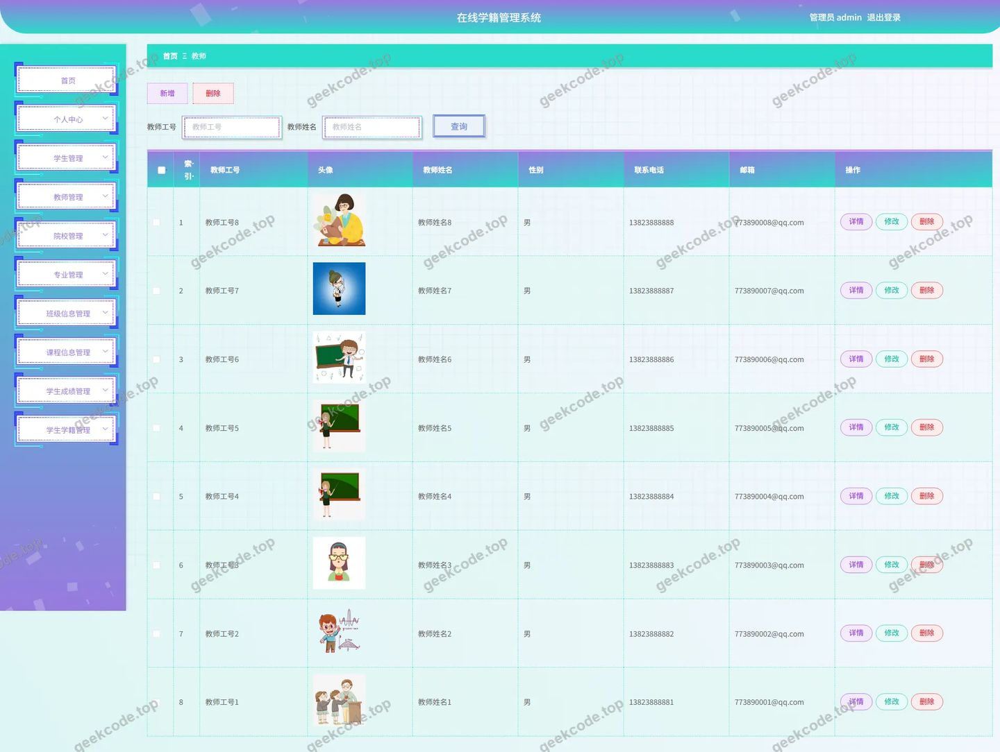</a>

<h4>后台-课程信息</h4>

<a href="https://geekcode.top/archives/%E5%9C%A8%E7%BA%BF%E5%AD%A6%E7%B1%8D%E7%AE%A1%E7%90%86%E7%B3%BB%E7%BB%9F-%E8%AE%BA%E6%96%87?utm_source=github" title="查看完整源码">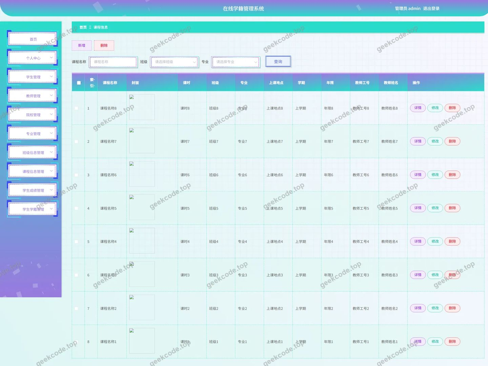</a>

<h4>后台-登录</h4>

<a href="https://geekcode.top/archives/%E5%9C%A8%E7%BA%BF%E5%AD%A6%E7%B1%8D%E7%AE%A1%E7%90%86%E7%B3%BB%E7%BB%9F-%E8%AE%BA%E6%96%87?utm_source=github" title="查看完整源码">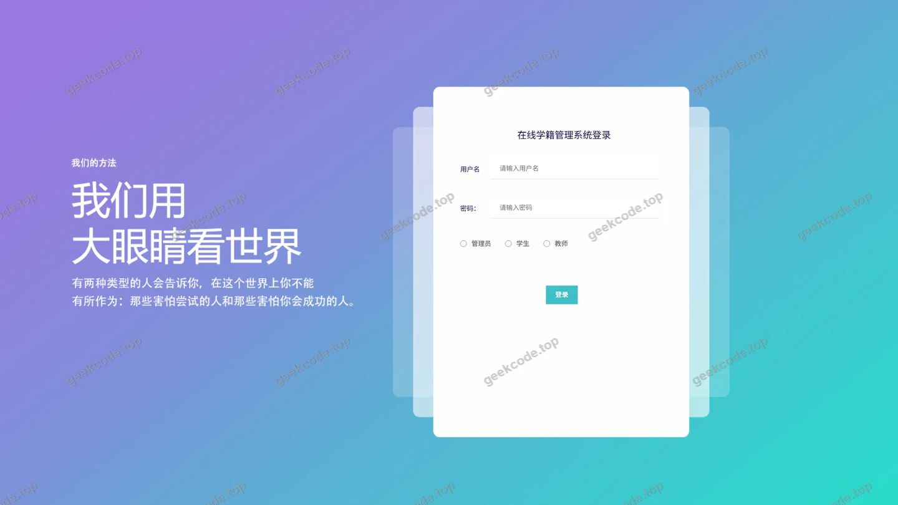</a>

<h4>后台-学生</h4>

<a href="https://geekcode.top/archives/%E5%9C%A8%E7%BA%BF%E5%AD%A6%E7%B1%8D%E7%AE%A1%E7%90%86%E7%B3%BB%E7%BB%9F-%E8%AE%BA%E6%96%87?utm_source=github" title="查看完整源码">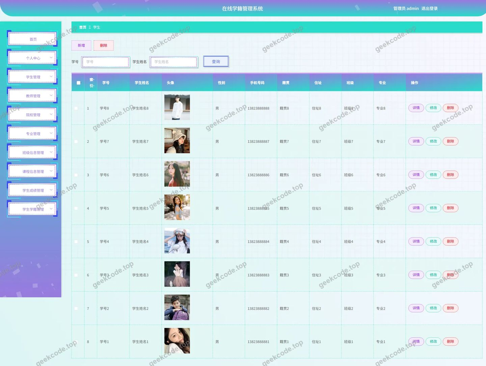</a>

<h4>后台-学生成绩</h4>

<a href="https://geekcode.top/archives/%E5%9C%A8%E7%BA%BF%E5%AD%A6%E7%B1%8D%E7%AE%A1%E7%90%86%E7%B3%BB%E7%BB%9F-%E8%AE%BA%E6%96%87?utm_source=github" title="查看完整源码">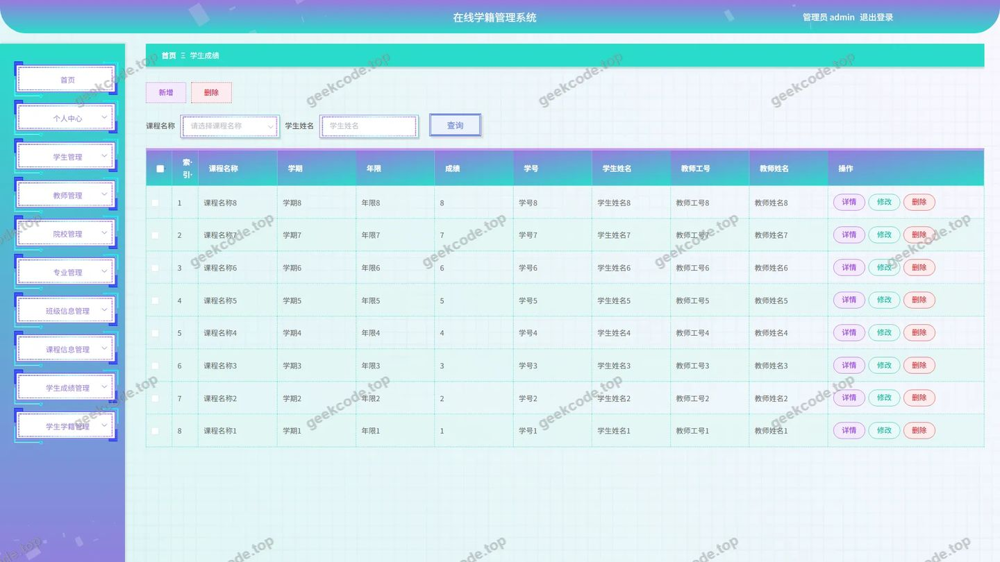</a>

<h4>后台-学生学籍</h4>

<a href="https://geekcode.top/archives/%E5%9C%A8%E7%BA%BF%E5%AD%A6%E7%B1%8D%E7%AE%A1%E7%90%86%E7%B3%BB%E7%BB%9F-%E8%AE%BA%E6%96%87?utm_source=github" title="查看完整源码">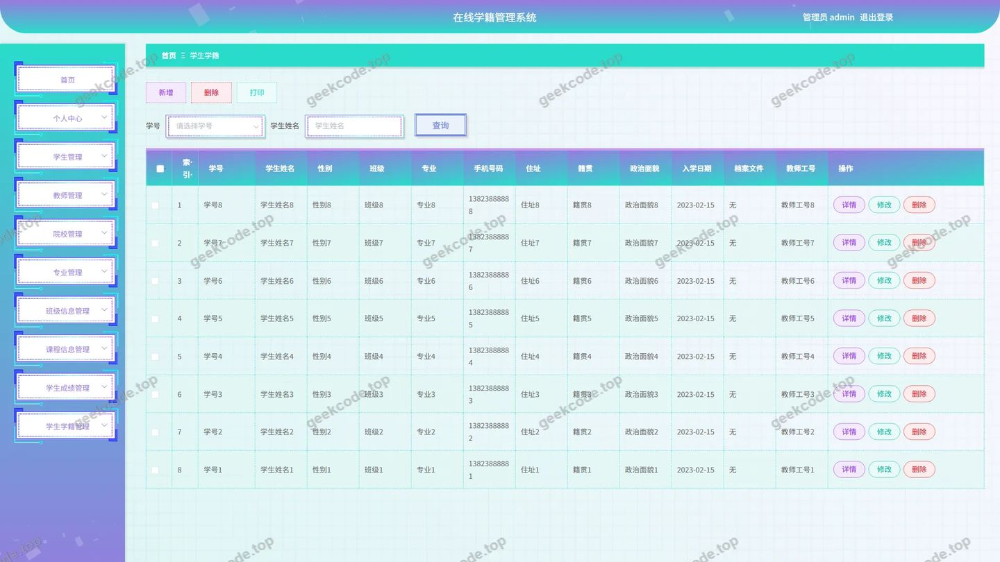</a>

<h4>后台-院校</h4>

<a href="https://geekcode.top/archives/%E5%9C%A8%E7%BA%BF%E5%AD%A6%E7%B1%8D%E7%AE%A1%E7%90%86%E7%B3%BB%E7%BB%9F-%E8%AE%BA%E6%96%87?utm_source=github" title="查看完整源码">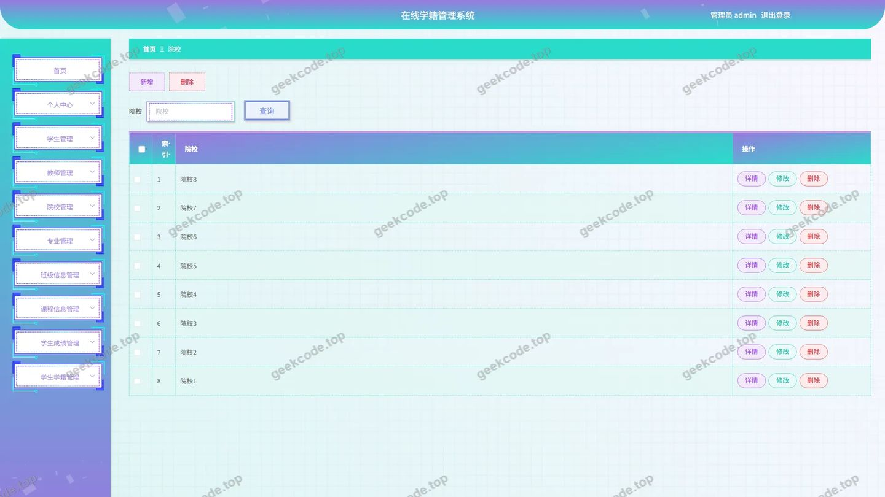</a>

<h4>后台-专业</h4>

<a href="https://geekcode.top/archives/%E5%9C%A8%E7%BA%BF%E5%AD%A6%E7%B1%8D%E7%AE%A1%E7%90%86%E7%B3%BB%E7%BB%9F-%E8%AE%BA%E6%96%87?utm_source=github" title="查看完整源码">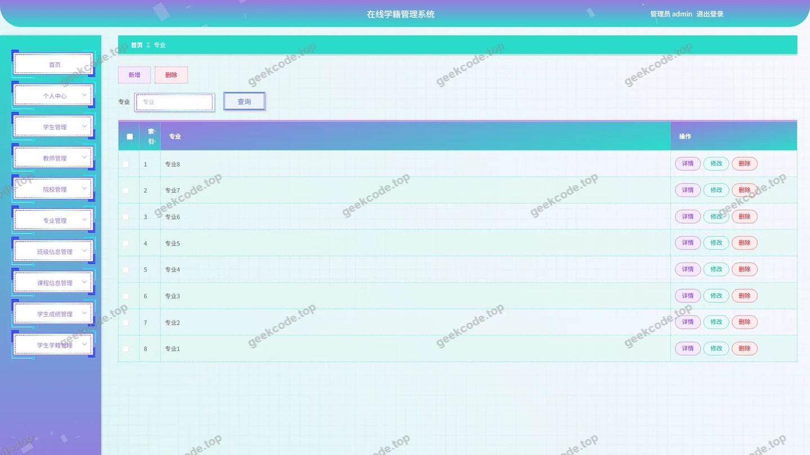</a>

---

## 获取完整源码

| 项目 | 说明 |
| --- | --- |
| 项目名 | 在线学籍管理系统--论文 |
| 运行截图 | 本文 11 张（站点带水印原图，仓库 `images/` 目录） |
| 完整源码 | [https://geekcode.top/archives/%E5%9C%A8%E7%BA%BF%E5%AD%A6%E7%B1%8D%E7%AE%A1%E7%90%86%E7%B3%BB%E7%BB%9F-%E8%AE%BA%E6%96%87?utm_source=github](https://geekcode.top/archives/%E5%9C%A8%E7%BA%BF%E5%AD%A6%E7%B1%8D%E7%AE%A1%E7%90%86%E7%B3%BB%E7%BB%9F-%E8%AE%BA%E6%96%87?utm_source=github) |
| 咨询微信 | **ir9372**（备注：jingpin-yuanma） |
| 更多项目 | [极客代码 geekcode.top](https://geekcode.top/?utm_source=github) |

> 需要源码、部署、改配置、跑不起来等问题，加微信 ir9372 沟通，说明项目名即可。
